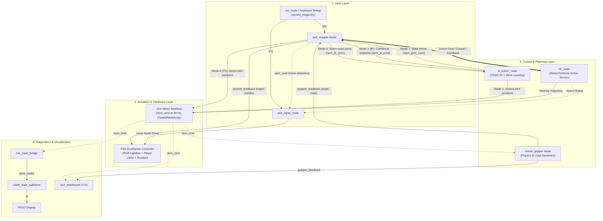

# 5-DOF Robotic Arm System (`arm_high_level`)

[](https://docs.ros.org/)
[](https://opensource.org/licenses/Apache-2.0)
[](./src/arm_controller/package.xml)
[](https://www.python.org/)
[](https://isocpp.org/)
[](https://github.com/Project-Kratos-28/arm_high_level)

A high-performance, real-time teleoperation, inverse kinematics, and trajectory execution stack for a 5-DOF articulated robotic arm with an end-effector gripper. Designed for low latency, smooth multi-mode teleoperation (Sony PS5 DualSense and keyboard), automated collision-checked homing, and live diagnostics.

---

## 1. Package Architecture

The repository is organized into four core ROS 2 packages:

- [**`arm_controller`**](./src/arm_controller): Contains the robot description (URDF / Xacro CAD model and meshes), MoveIt 2 configuration files (SRDF, kinematics, joint limits), visualization bridges, the live rich-based TUI telemetry dashboard ([`arm_dashboard.py`](./src/arm_controller/src/arm_dashboard.py)), keyboard teleoperation fallback ([`test_with_keyboard.py`](./src/arm_controller/src/test_with_keyboard.py)), and the master launch orchestration ([`arm.launch.py`](./src/arm_controller/launch/arm.launch.py)).
- [**`ik_motion_planner`**](./src/ik_motion_planner): Houses the high-speed C++ kinematic solver and motion action nodes:
  - **`ik_solver_node`**: High-rate 3-DOF inverse kinematics solver leveraging the TRAC-IK kinematics plugin and MoveIt 2, combined with analytical closed-form wrist leveling relative to the ground horizon.
  - **`rth_node`**: ROS 2 action server (`ReturnToHome.action`) executing smooth, collision-checked cubic polynomial homing trajectories.
  - **Developer & Verification Tools**: Standalone C++ and Python tools for workspace reachability profiling and parametric TRAC-IK solver benchmarks (`trac_ik_benchmark`, `fk_ik_reachability_checker`, `plot_workspace_map.py`).
- [**`mapper`**](./src/mapper): Real-time teleoperation, control mapping, and hardware feedback nodes:
  - **`ps5_mapper`**: 50 Hz teleoperation engine translating DualSense and keyboard inputs into coordinated joint commands (`/arm_cmd`), enforcing bumpless FK $\leftrightarrow$ IK mode switching, dominant-axis filtering, anti-windup leashing, and haptic rumble alerts.
  - **`ps5_lights_node`**: Real-time hardware status synchronizer driving PS5 DualSense touchpad RGB lighting and 5 white player indicator LEDs via Linux sysfs, with automatic hotplug and replug resilience.
  - **`virtual_gripper`**: Physics simulation node calculating continuous gripper opening/closing dynamics, contact obstacles, grip load buildup, and `/gripper_feedback` generation.
- [**`arm_interfaces`**](./src/arm_interfaces): Custom ROS 2 interface package defining the [`ReturnToHome.action`](./src/arm_interfaces/action/ReturnToHome.action) action specification.

---

## 2. Teleoperation & Control Guide

The system supports primary control via a **PlayStation 5 (DualSense) controller** and a full **keyboard teleop fallback**.

### 2.1. Master Controls & Safety Matrix

| Action | PS5 Controller | Keyboard Key | Description |
|---|---|---|---|
| **Toggle Mode (FK $\leftrightarrow$ IK)** | **OPTIONS** button | **`M`** | Switches between Forward Kinematics (joint-by-joint) and Inverse Kinematics (cylindrical reach/elevation). Bumpless transition with zero jump. |
| **Return to Home (RTH)** | **SHARE** button | **`H`** | **1st press**: Starts automated, smooth return trajectory to home.<br>**2nd press**: Instantly cancels RTH and halts arm in place. |
| **Emergency Stop / Lock** | **PS** button | **`X`** | Latches motion lock on/off. When active, all joint commands freeze in place. |
| **Gripper Open / Close** | **D-Pad Left** / **Right** | **`[`** / **`]`** | **D-Pad Left / `[`**: Open jaw (+1.0 momentary speed).<br>**D-Pad Right / `]`**: Close jaw (-1.0 momentary speed).<br>Releasing stick/key stops gripper (0.0 neutral hold). |
| **Precision Crawl Mode** | Hold **LB** (Left Bumper) | **`C`** (toggle) | Drops all arm movement speeds to **30%** for fine manipulation. |
| **Orientation Layer Toggle** | Hold **RB** (Right Bumper) | **`R`** (toggle) | Shifts Right Stick control from arm positioning to wrist orientation. |
| **Stop / Center Axes** | Release sticks | **`SPACE`** | Centers stick inputs and stops moving immediately. |

---

### 2.2. Mode 0: Forward Kinematics (FK Joint Mode)
In FK mode, you command each individual joint angle directly:

- **Left Stick Left / Right** (`A` / `D`): Rotate **Base Yaw** ($[-180^\circ, +180^\circ]$).
- **Left Stick Up / Down** (`W` / `S`): Pitch **Shoulder** ($[-90^\circ, +90^\circ]$).
- **Right Stick Up / Down** (`I` / `K`): Pitch **Elbow** ($[0^\circ, +143.2^\circ]$ forward from straight reference).
- **With RB Held (Wrist Gimbal Layer)**:
  - **Right Stick Up / Down** (`U` / `O`): Pitch **Wrist** ($[-90^\circ, +90^\circ]$ relative to forearm).
  - **Right Stick Left / Right** (`J` / `L`): Roll **Wrist** ($[-180^\circ, +180^\circ]$ axial rotation).
- **Gripper**: **D-Pad Left** (Open) / **D-Pad Right** (Close) ($[0^\circ, 90^\circ]$ range).

---

### 2.3. Mode 1: Inverse Kinematics (IK Cartesian Mode)
In IK mode, the TRAC-IK solver coordinates the arm joints to move the wrist center in cylindrical task space ($r, \theta, z$):

- **Left Stick Left / Right** (`A` / `D`): **Base Azimuth** ($\theta$, orbit left / right around base pivot).
- **Left Stick Up / Down** (`W` / `S`): **Radial Reach** ($r$, extend outward or pull inward in a straight line).
- **Right Stick Up / Down** (`I` / `K`): **Elevation** ($z$, raise or lower vertically in a straight line).
- **With RB Held (Orientation Layer)**:
  - **Right Stick Up / Down**: **World Pitch** (tilt wrist relative to the ground horizon; arm auto-levels as it moves).
  - **Right Stick Left / Right**: **Axial Roll** (spin wrist roll joint).
- **Gripper**: **D-Pad Left** (Open) / **D-Pad Right** (Close).

---

### 2.4. On-the-Fly Speed Tuning (PS5 Controller Only)
Adjust joint and Cartesian speed limits at runtime without restarting nodes:

1. **Hold a Shape Button** to select the target axis:
   - Hold **CROSS ($\times$)**: Base Yaw (FK) / Azimuth (IK)
   - Hold **SQUARE ($\square$)**: Shoulder Pitch (FK) / Reach (IK)
   - Hold **CIRCLE ($\bigcirc$)**: Elbow Pitch (FK) / Elevation (IK)
   - Hold **TRIANGLE ($\triangle$)**: Wrist Pitch & Roll (FK/IK)
2. **Press Triggers** while holding the button:
   - Pull **RT** (Right Trigger): **Increase** speed (+0.02 rad/s or m/s).
   - Pull **LT** (Left Trigger): **Decrease** speed (-0.02 rad/s or m/s).

*(Note: Arm movement is locked out while holding shape buttons to prevent unintended motion during adjustment).*

---

### 2.5. Operator Protections & Haptic Rumble Alerts

- **Dominant-Axis Stick Lock**: Filters analog stick inputs to lock onto your primary direction (horizontal or vertical), eliminating diagonal cross-talk. Smoothly transfers when intentional diagonal deflection exceeds hysteresis threshold.
- **Dynamic Anti-Windup Leash**: In IK mode, target coordinates cannot drift more than 25 mm ahead of the physical arm. Reaching workspace boundaries does not cause command windup—reversing direction responds instantly with zero lag.
- **Spherical Kinematic Envelope**: Wrist target coordinates are strictly bounded inside the physical arm reach sphere ($r^2 + (z - z_{shoulder})^2 \le R^2$), preventing the solver from entering unreachable singularities.
- **Signal-Loss Watchdog**: If `/joy` messages cease for >0.2 seconds, the arm automatically holds its last commanded setpoints.
- **RTH Watchdog Lockdown**: If communication drops while Return-to-Home is active, the RTH action goal is immediately canceled and arm motion is locked down.
- **DualSense Haptic Rumble**:
  - **Limit Rumble**: Pulling the D-Pad to open or close the gripper when already at physical limits ($0.00$ or $1.57$ rad) triggers an instant tactile rumble alert.
  - **Load Rumble**: Grip load resistance generates proportional dual-motor vibration on the controller grips.

---

### 2.6. PS5 Controller Lighting & Status Indication

The PS5 DualSense touchpad RGB lightbar and 5 white player indicator LEDs (`[LED 1, LED 2, LED 3, LED 4, LED 5]`) provide real-time hardware status feedback synchronized with the terminal dashboard:

| Mode / System State | PS5 RGB Lightbar | PS5 Player Indicator LEDs | Dashboard Styling | Meaning |
|---|---|---|---|---|
| **FK Joint Mode (Mode 0)** | **Sky Blue / Cyan** (`#00B4FF`) Solid | `· · ● · ·` (Center: LED 3) | **Bold Cyan** border / badge | Direct joint-by-joint angle integration |
| **IK Cartesian Mode (Mode 1)** | **Emerald Green** (`#00FF3C`) Solid | `· ● · ● ·` (Pair: LEDs 2 & 4) | **Bold Green** border / badge | Cylindrical task-space Cartesian control |
| **Emergency Stop (E-Stop)** | **Bright Red** (`#FF0000`) 1 Hz Flash | `● ● ● ● ●` All 5 LEDs flash at 1 Hz | **Bright Red 1 Hz Flash** | Motion locked; arm frozen in place |
| **Return-to-Home (RTH)** | **Golden Yellow** (`#FFD700`) 1 Hz Pulse | **Inward Sweep**:<br>`● · · · ●` → `· ● · ● ·` → `· · ● · ·` | **Bold Yellow** border / badge | Homing trajectory. **Auto-resets on arrival**. |
| **Precision Crawl (LB Held)** | **Violet / Purple** (`#B400FF`) Solid | **Leftmost LED 1 turns ON**:<br>• FK: `● · ● · ·`<br>• IK: `● ● · ● ·` | `Precision Mode:`<br>`[bold magenta]Engaged (30%)[/bold magenta]` | Speeds scaled to 30% for fine positioning |
| **Orientation Layer (RB Held)** | *Preserves base color* (Cyan/Green) | **Rightmost LED 5 turns ON**:<br>• FK: `· · ● · ●`<br>• IK: `· ● · ● ●` | `Right Stick Controls:`<br>`[bold cyan]Wrist Pitch & Roll[/bold cyan]` | Right stick controls wrist pitch & roll |
| **Speed Tuning (Shape Held)** | **Solid Amber** (`#FF9900`) Solid | `● ● ● ● ●` All 5 LEDs solid | Tuning axis highlighted in table | Arm locked out while adjusting max speeds |
| **Gripper Contact / Grasp** | **Soft Cyan Flash** (`#64E5FF`, 300ms) | *Preserves active mode LEDs* | `[bold green]Gripping (LOAD)[/bold green]` | Tactile visual confirmation of grip load |
| **Joystick Signal Loss** | *Controller holds state* | *Controller holds state* | `[NO JOY]` flashing at 0.5 Hz | Watchdog alert: no joystick communication |

- **Bumper LED Intuition**: Physical bumpers map directly to outer LEDs: Left Bumper (LB) lights **LED 1 (Leftmost)**, and Right Bumper (RB) lights **LED 5 (Rightmost)**.
- **RTH 3-Layer Auto-Reset**: The golden yellow breathing pulse and inward LED sweep automatically clear upon reaching home via: (1) action server goal completion, (2) joint command proximity within 0.02 rad of home, or (3) operator manual stick input.
- **Dynamic Hotplug Resilience**: If the controller is disconnected or replugged mid-session, `ps5_lights_node` automatically re-binds to the newly enumerated Linux sysfs path and immediately flushes the active color and LED preset to the controller without restarting any nodes.

---

## 3. System Architecture & Data Flow



### Key Message & Topic Specifications:
- **`/arm_cmd`** (`std_msgs/msg/Float32MultiArray`): 6-element position command array streamed at 50 Hz: `[base_yaw, shoulder_pitch, elbow_pitch, wrist_pitch, wrist_roll, gripper]`.
- **`/arm_ik_cmd`** (`std_msgs/msg/Float32MultiArray`): 6-element cylindrical IK target array: `[reach_r, azimuth_theta, elev_z, world_pitch, wrist_roll, gripper]`.
- **`/gripper_feedback`** (`std_msgs/msg/Float32MultiArray`): 2-element feedback: `[current_angle_rad, measured_load]`.
- **`/joy/set_feedback`** (`sensor_msgs/msg/JoyFeedback`): DualSense haptic rumble frequency and intensity.

---

## 4. Live Diagnostics & Telemetry Dashboard

The repository includes a live, terminal-based telemetry dashboard ([`arm_dashboard.py`](./src/arm_controller/src/arm_dashboard.py)) powered by the `rich` library. When launched via `dashboard:=true`, it automatically detects your system's terminal emulator (`gnome-terminal`, `terminator`, `xterm`, `alacritty`, `konsole`, `xfce4-terminal`) and spawns into a dedicated popup window to prevent ROS 2 launch log clutter.

### Dashboard Key Features:
- **Live Frequency Estimators**: Real-time sliding-window rate tracking for `/arm_cmd`, `/joy`, and `/gripper_feedback`.
- **Master State Banner**: Color-coded indication of current control state (Mode 0 FK Cyan, Mode 1 IK Green, RTH Yellow, E-Stop Red, Joy Timeout warning).
- **Context-Sensitive Speed Trims**: Displays FK joint speed trims in Mode 0 and Cartesian translational/angular trims in Mode 1.
- **Physical vs. Ground-Relative Angles**: Live display of actuator angles alongside gravity/ground-relative pitch for shoulder and elbow.

### Interactive Tab Navigation:
Press keys while focused on the dashboard window:
- **`1`**: Switch to **Overview Tab** (System banner, key joint angles, Cartesian pose, topic rates, gripper load).
- **`2`**: Switch to **Joints & Limits Tab** (All 6 joints with visual bar gauges, min/max software limits, and angular velocities).
- **`3`**: Switch to **Task-Space & RTH Tab** (Cylindrical coords $r, \theta, z$, dynamic leash displacement, spherical boundary margin, and RTH action progress).
- **`4`**: Switch to **Speed Trims & Logs Tab** (Active max speed limits, precision scale status, and live filtered ROS 2 console logs).
- **`TAB` / `SPACE`**: Cycle forward to next tab.
- **`Shift-TAB` / `B`**: Cycle backward to previous tab.
- **`A`**: Toggle automatic tab auto-cycling (switches tabs every 2 seconds).
- **`Q`**: Exit dashboard.

---

## 5. Quick Start Guide

### 5.1. Prerequisites & Dependencies
- **Ubuntu 22.04 LTS / 24.04 LTS** with **ROS 2 Humble / Iron**
- MoveIt 2 and TRAC-IK kinematics plugin
- Python `rich` library for TUI telemetry

```bash
# Update package lists and install ROS 2 core packages
sudo apt update
sudo apt install -y \
  ros-${ROS_DISTRO}-moveit-core \
  ros-${ROS_DISTRO}-moveit-ros-planning \
  ros-${ROS_DISTRO}-trac-ik-kinematics-plugin \
  ros-${ROS_DISTRO}-joy \
  ros-${ROS_DISTRO}-robot-state-publisher \
  ros-${ROS_DISTRO}-rviz2 \
  ros-${ROS_DISTRO}-xacro

# Install Python requirements
pip install rich
```

### 5.2. Workspace Setup & Build

1. **Clone repository into your workspace**:
   ```bash
   mkdir -p ~/arm_ws/src
   cd ~/arm_ws/src
   git clone https://github.com/Project-Kratos-28/arm_high_level.git .
   ```

2. **Install remaining dependencies via rosdep**:
   ```bash
   cd ~/arm_ws
   rosdep update
   rosdep install --from-paths src --ignore-src -r -y
   ```

3. **Build workspace with colcon**:
   ```bash
   colcon build --symlink-install
   ```
   *(Optional: To build development benchmarking & reachability analysis tools, add `--cmake-args -DBUILD_DEV_TOOLS=ON`).*

4. **Source the workspace overlay**:
   ```bash
   source install/setup.bash
   ```

5. **Configure DualSense Controller permissions (One-time setup)**:
   ```bash
   bash src/mapper/scripts/setup_dualsense_udev.sh
   ```
   > [!IMPORTANT]
   > This script configures `/etc/udev/rules.d/70-dualsense.rules` to grant non-root write permissions exclusively to the DualSense LEDs (`0666`) while preserving `0600` on `/dev/hidraw*`. This ensures SDL2 / `joy_node` continues to use standard 8-axis evdev joystick mapping rather than switching to an incompatible internal HIDAPI driver.

---

### 5.3. Running the System

#### Complete Launch (Teleop + RViz + Live Dashboard + Controller Lighting)
```bash
ros2 launch arm_controller arm.launch.py rviz:=true dashboard:=true
```

#### Headless Launch (Hardware / Robot On-Board Execution)
```bash
ros2 launch arm_controller arm.launch.py rviz:=false dashboard:=false
```

#### Launch Arguments Reference:
- `rviz` (*default: `false`*): Spawns `rviz2`, `robot_state_publisher`, and `rviz_topic_bridge`.
- `dashboard` (*default: `false`*): Spawns `arm_dashboard` in a dedicated terminal window.
- `lights` (*default: `true`*): Runs `ps5_lights_node` for DualSense lightbar and player LED tracking.
- `use_sim_time` (*default: `false`*): Enables ROS simulation clock.

---

### 5.4. Standalone Nodes & Simulation Utilities

- **Keyboard Teleop Fallback**:
  ```bash
  ros2 run arm_controller test_with_keyboard.py
  ```
- **Standalone Telemetry Dashboard**:
  ```bash
  ros2 run arm_controller arm_dashboard.py
  ```
- **Virtual Gripper Physics Node**:
  ```bash
  ros2 run mapper virtual_gripper
  ```
- **Verification & Benchmarking Tools** (built with `-DBUILD_DEV_TOOLS=ON`):
  ```bash
  # Launch TRAC-IK solver parametric sweep benchmark:
  ros2 launch ik_motion_planner trac_ik_benchmark.launch.py

  # Launch Forward / Inverse kinematics reachability checker:
  ros2 launch ik_motion_planner fk_ik_reachability_checker.launch.py

  # Plot workspace reachability heatmap:
  python3 src/ik_motion_planner/scripts/plot_workspace_map.py
  ```

---

### 5.5. Running Automated Unit Tests
To run unit and integration tests across the stack:
```bash
# Run pytest directly on mapper test suite (includes RTH watchdog and lights tests)
pytest src/mapper/test

# Or run via colcon
colcon test --packages-select mapper arm_controller ik_motion_planner
colcon test-result --all
```

---

### 5.6. PS5 Controller Lighting CLI Testing
You can interactively test or command the controller's RGB lightbar and LEDs directly via standard ROS 2 CLI commands:

```bash
# Set RGB color (Red, Green, Blue, Brightness):
ros2 topic pub --once /ps5_lights/set_color std_msgs/msg/ColorRGBA "{r: 0.0, g: 0.7, b: 1.0, a: 1.0}"

# Set animation effect ('solid', 'pulse', 'blink', 'rainbow', 'off'):
ros2 topic pub --once /ps5_lights/set_effect std_msgs/msg/String "{data: 'rainbow'}"

# Set player indicator LEDs (1-5 or 5-bit mask):
ros2 topic pub --once /ps5_lights/set_player_leds std_msgs/msg/Int32 "{data: 0b01010}"

# Force preset or restore auto mode tracking ('auto', 'fk', 'ik', 'estop', 'rth', 'rainbow', 'off'):
ros2 topic pub --once /ps5_lights/set_mode std_msgs/msg/String "{data: 'auto'}"

# View live lighting & hardware connection status:
ros2 topic echo /ps5_lights/status
```

---

## 6. License & Maintainer

- **Maintainer**: Shlok (`wizard1net@gmail.com`)
- **Repository**: [https://github.com/Project-Kratos-28/arm_high_level](https://github.com/Project-Kratos-28/arm_high_level)
- **License**: Released under the **Apache-2.0 License**. See individual [`package.xml`](./src/arm_controller/package.xml) files for details.
