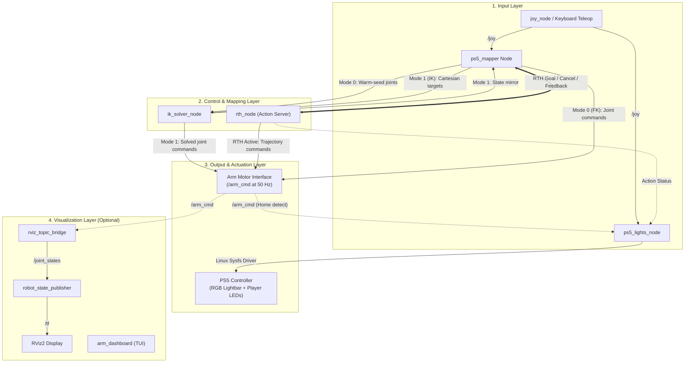

# 5-DOF Robotic Arm System


## 1. Package Overview

The repository is organized into four core packages:

- [**`arm_controller`**](./src/arm_controller): Contains the robot description (URDF / Xacro CAD model and meshes), MoveIt 2 configuration files (SRDF, kinematics, joint limits), visualization bridges, and the main launch file ([`arm.launch.py`](./src/arm_controller/launch/arm.launch.py)).
- [**`ik_motion_planner`**](./src/ik_motion_planner): Houses the C++ kinematic solver and motion nodes:
  - **`ik_solver_node`**: Solves 3-DOF inverse kinematics using the TRAC-IK solver and analytically levels the wrist relative to the ground.
  - **`rth_node`**: Action server providing automated, collision-checked Return-to-Home trajectory execution.
- [**`mapper`**](./src/mapper): Houses teleoperation and controller interface nodes:
  - **`ps5_mapper`**: Translates controller and keyboard inputs into 50 Hz arm position commands, manages control modes, and enforces safety bounds.
  - **`ps5_lights_node`**: Synchronizes PS5 DualSense touchpad RGB lighting and 5 player indicator LEDs with active teleop modes, featuring seamless hotplug/replug resilience.
- [**`arm_interfaces`**](./src/arm_interfaces): Defines custom ROS 2 interfaces, primarily the [`ReturnToHome.action`](./src/arm_interfaces/action/ReturnToHome.action) action definition.

---

## 2. Teleoperation Controls Guide

The arm supports both a **PlayStation 5 (DualSense) controller** and a **keyboard fallback**.

### 2.1. Operating Modes & Global Safety Controls

| Action | PS5 Controller | Keyboard Key | Description |
|---|---|---|---|
| **Toggle Mode (FK $\leftrightarrow$ IK)** | **OPTIONS** button | **`M`** | Switches between Forward Kinematics (joint-by-joint) and Inverse Kinematics (Cartesian reach/elevation). Transition is bumpless with zero jump. |
| **Return to Home (RTH)** | **SHARE** button | **`H`** | **1st press**: Automatically and smoothly returns the arm to its resting home position.<br>**2nd press**: Instantly cancels RTH and halts the arm where it stands. |
| **Emergency Stop / Lock** | **PS** button | **`X`** | Latches motion lock on/off. When active, all arm position commands are frozen in place. |
| **Precision Crawl Mode** | Hold **LB** (Left Bumper) | **`C`** (toggle) | Drops all arm movement speeds to **30%** for fine positioning. |
| **Orientation Layer Toggle** | Hold **RB** (Right Bumper) | **`R`** (toggle) | Shifts Right Stick control from arm positioning to wrist orientation. |
| **Stop / Center Axes** | Release sticks | **`SPACE`** | Centers stick inputs and stops moving. |

---

### 2.2. Mode 0: Forward Kinematics (FK Mode)
In FK mode, you control each individual joint angle directly.

- **Left Stick Left / Right** (`A` / `D`): Rotate **Base Yaw** (turntable left / right).
- **Left Stick Up / Down** (`W` / `S`): Pitch **Shoulder** (tilt upper arm forward / back).
- **Right Stick Up / Down** (`I` / `K`): Pitch **Elbow** (tilt forearm up / down).
- **With RB Held (Wrist Layer)**:
  - **Right Stick Up / Down** (`U` / `O`): Pitch **Wrist** (tilt wrist up / down).
  - **Right Stick Left / Right** (`J` / `L`): Roll **Wrist** (rotate wrist axially clockwise / counter-clockwise).

---

### 2.3. Mode 1: Inverse Kinematics (IK Mode)
In IK mode, the computer automatically coordinates all arm joints to move the arm tip smoothly through space using cylindrical coordinates.

- **Left Stick Left / Right** (`A` / `D`): **Base Azimuth** (orbit/sweep the arm left or right around the base).
- **Left Stick Up / Down** (`W` / `S`): **Radial Reach** (extend the arm outward or pull it inward in a straight line).
- **Right Stick Up / Down** (`I` / `K`): **Elevation** (raise or lower the arm vertically straight up and down).
- **With RB Held (Orientation Layer)**:
  - **Right Stick Up / Down**: **World Pitch** (tilt the wrist up or down relative to the ground horizon; the arm auto-levels as it moves).
  - **Right Stick Left / Right**: **Axial Roll** (spin the wrist roll joint).

---

### 2.4. On-the-Fly Speed Tuning (PS5 Controller Only)
You can increase or decrease joint and Cartesian speeds without restarting any nodes:

1. **Hold a Shape Button** to select the movement to trim:
   - Hold **CROSS ($\times$)**: Base Yaw (FK) / Azimuth (IK)
   - Hold **SQUARE ($\square$)**: Shoulder Pitch (FK) / Reach (IK)
   - Hold **CIRCLE ($\bigcirc$)**: Elbow Pitch (FK) / Elevation (IK)
   - Hold **TRIANGLE ($\triangle$)**: Wrist Pitch & Roll (FK/IK)
2. **Press Triggers** while holding the button:
   - Pull **RT** (Right Trigger): **Increase** speed (+0.02 rad/s or m/s).
   - Pull **LT** (Left Trigger): **Decrease** speed (-0.02 rad/s or m/s).

*(Note: The arm is temporarily locked while holding shape buttons to prevent accidental movement during speed adjustments).*

---

### 2.5. Built-In Operator Protections

- **Dominant-Axis Lock**: When moving a stick, the mapper locks onto your primary direction (horizontal or vertical) to eliminate accidental diagonal cross-talk. If you deliberately push strongly in the other direction, it smoothly transfers without getting stuck.
- **Dynamic Anti-Windup Leash**: In IK mode, the virtual target cannot drift more than 25 mm ahead of the physical arm. If you reach maximum extension and push forward, the command does not run away—pulling backward responds instantly with zero lag.
- **Signal-Loss Watchdog**: If communication with the controller drops for more than 0.2 seconds, the arm automatically holds its last commanded position.

---

### 2.6. PS5 Controller Lighting & Status Indication

The PS5 DualSense controller's touchpad RGB lightbar and 5 white player indicator LEDs (`[LED 1, LED 2, LED 3, LED 4, LED 5]`) provide real-time hardware status feedback synchronized with the terminal dashboard:

| Mode / System State | PS5 RGB Lightbar | PS5 Player Indicator LEDs | Dashboard Styling | Meaning |
|---|---|---|---|---|
| **FK Joint Mode (Mode 0)** | **Sky Blue / Cyan** (`#00B4FF`) Solid | `· · ● · ·` (Center dot: LED 3) | **Bold Cyan** border / badge | Direct joint-by-joint angle integration |
| **IK Cartesian Mode (Mode 1)** | **Emerald Green** (`#00FF3C`) Solid | `· ● · ● ·` (Middle pair: LEDs 2 & 4) | **Bold Green** border / badge | Cylindrical task-space Cartesian control |
| **Emergency Stop (E-Stop)** | **Bright Red** (`#FF0000`) 1 Hz Flash | `● ● ● ● ●` All 5 LEDs flash at 1 Hz | **Bright Red 1 Hz Flash** | Motion locked; arm frozen in place |
| **Return-to-Home (RTH)** | **Golden Yellow** (`#FFD700`) 1 Hz Pulse | **Inward Sweep**:<br>`● · · · ●` → `· ● · ● ·` → `· · ● · ·` | **Bold Yellow** border / badge | Homing trajectory. **Auto-resets on arrival**. |
| **Precision Crawl (LB Held)** | **Violet / Purple** (`#B400FF`) Solid | **Leftmost LED 1 turns ON**:<br>• FK: `● · ● · ·`<br>• IK: `● ● · ● ·` | `Precision Mode:`<br>`[bold magenta]Engaged (30%)[/bold magenta]` | Speeds scaled to 30% for fine positioning |
| **Orientation Layer (RB Held)** | *Preserves base color* (Cyan/Green) | **Rightmost LED 5 turns ON**:<br>• FK: `· · ● · ●`<br>• IK: `· ● · ● ●` | `Right Stick Controls:`<br>`[bold cyan]Wrist Pitch & Roll[/bold cyan]` | Right stick controls wrist pitch & roll |
| **Speed Tuning (Shape Held)** | **Solid Amber** (`#FF9900`) Solid | `● ● ● ● ●` All 5 LEDs solid | Tuning axis highlighted in table | Arm locked out while adjusting max speeds |
| **Gripper Contact / Grasp** | **Soft Cyan Flash** (`#64E5FF`, 300ms) | *Preserves active mode LEDs* | `[bold green]Gripping (LOAD)[/bold green]` | Tactile visual confirmation of grip load |
| **Joystick Signal Loss** | *Controller holds state* | *Controller holds state* | `[NO JOY]` flashing at 0.5 Hz | Watchdog alert: no joystick communication |

- **Bumper LED Intuition**: Physical bumpers map directly to outer LEDs: Left Bumper (LB) lights **LED 1 (Leftmost)**, and Right Bumper (RB) lights **LED 5 (Rightmost)**.
- **RTH 3-Layer Auto-Reset**: The golden yellow breathing pulse and inward LED sweep automatically clear upon reaching home via: (1) action server goal completion, (2) joint command proximity within 0.02 rad of home, or (3) operator manual stick input.
- **Dynamic Hotplug Resilience**: If the controller is disconnected or replugged mid-session, `ps5_lights_node` automatically re-binds to the newly enumerated Linux sysfs path and immediately flushes the active color and LED preset to the controller without needing to restart any nodes.

---

## 3. System Architecture

The system uses a modular node network communicating over standard ROS 2 topics and actions:



### How the Data Flows:

1. **User Input**:
   - `joy_node` or `test_with_keyboard.py` reads user input and publishes controller states on `/joy`.
2. **Mapping & Control**:
   - `ps5_mapper` receives `/joy` messages and updates target positions at a steady 50 Hz.
   - In **FK Mode (Mode 0)**: The mapper calculates joint angles and publishes directly to the motor command topic `/arm_cmd`.
   - In **IK Mode (Mode 1)**: The mapper calculates Cartesian coordinates and sends them to `ik_solver_node`. The solver calculates the required joint angles using TRAC-IK and MoveIt, ensures the wrist stays level with the horizon, and outputs the resulting joints to `/arm_cmd`.
   - In **Return-to-Home**: The mapper sends an action goal to `rth_node`. The server checks the trajectory for joint limits and self-collisions, then streams a smooth step-by-step return trajectory directly to `/arm_cmd`.
3. **Actuation & Visualization**:
   - The physical arm motors listen on `/arm_cmd` for continuous 50 Hz position setpoints.
   - When launched with visualization (`rviz:=true`), `rviz_topic_bridge` copies `/arm_cmd` into `/joint_states`, allowing `robot_state_publisher` and `rviz2` to show the live arm pose.
4. **Lighting & Dashboard Telemetry**:
   - `ps5_lights_node` tracks arm modes and transitions via `/joy`, `/arm_cmd`, and action statuses, directly manipulating DualSense RGB lightbar colors and player indicator LEDs at 25 Hz.
   - `arm_dashboard` displays live joint positions, rates, and mode banners in matching color schemes.

---

## 4. Quick Start

### 4.1. ROS 2 Workspace Setup & Build

1. **Create a workspace directory**:
   ```bash
   mkdir -p ~/arm_ws/src
   cd ~/arm_ws/src
   ```

2. **Clone this repository into the `src` folder**:
   ```bash
   git clone https://github.com/Project-Kratos-28/arm_high_level.git
   ```

3. **Install dependencies**:
   ```bash
   cd ~/arm_ws
   rosdep update
   rosdep install --from-paths src --ignore-src -r -y
   pip install rich  # Required for the live telemetry dashboard
   ```

4. **Build the workspace with colcon**:
   ```bash
   colcon build --symlink-install
   ```

5. **Configure DualSense Controller permissions (One-time setup)**:
   ```bash
   bash src/mapper/scripts/setup_dualsense_udev.sh
   ```
   *(Grants non-root access to `/sys/class/leds/*` while enforcing `0600` on `hidraw*` so SDL2 maintains standard 8-axis evdev joystick mapping).*

6. **Source the workspace overlay**:
   ```bash
   source install/setup.bash
   ```
   *(Optional: Add `source ~/arm_ws/install/setup.bash` to your `~/.bashrc` to source it automatically in new terminals).*

---

### 4.2. Launching the Complete System
To launch the full teleoperation system with RViz visualization:
```bash
ros2 launch arm_controller arm.launch.py rviz:=true # defaults to rviz:=false
```

To launch headless on the robot hardware without visualizer overhead:
```bash
ros2 launch arm_controller arm.launch.py rviz:=false
```

*(Note: DualSense controller lighting node `ps5_lights_node` is enabled by default via `lights:=true`; set `lights:=false` if running without physical controller lights).*

### 4.3. Live Telemetry Dashboard
To launch the complete system with the live color-coded telemetry dashboard spawned in its own dedicated window (preventing console log interference):
```bash
ros2 launch arm_controller arm.launch.py dashboard:=true # defaults to dashboard:=false
```

Or combine with RViz visualization:
```bash
ros2 launch arm_controller arm.launch.py rviz:=true dashboard:=true
```

You can also run the dashboard standalone in any open terminal window:
```bash
ros2 run arm_controller arm_dashboard.py
```

### 4.4. Keyboard Teleop Fallback
If testing without a physical DualSense controller:
```bash
ros2 run arm_controller test_with_keyboard.py
```
*(Press `Q` in the terminal to exit).*

### 4.5. Manual PS5 Controller Lighting Control (CLI)
You can directly command the DualSense lights or test lighting effects via standard ROS 2 topics:

```bash
# Set RGB color (Red, Green, Blue, Alpha/Brightness):
ros2 topic pub --once /ps5_lights/set_color std_msgs/msg/ColorRGBA "{r: 0.0, g: 0.7, b: 1.0, a: 1.0}"

# Set animation effect ('solid', 'pulse', 'blink', 'rainbow', 'off'):
ros2 topic pub --once /ps5_lights/set_effect std_msgs/msg/String "{data: 'rainbow'}"

# Set player indicator LEDs (1-5 or 5-bit mask):
ros2 topic pub --once /ps5_lights/set_player_leds std_msgs/msg/Int32 "{data: 0b01010}"

# Force preset or restore auto mode tracking ('auto', 'fk', 'ik', 'estop', 'rth', 'rainbow', 'off'):
ros2 topic pub --once /ps5_lights/set_mode std_msgs/msg/String "{data: 'auto'}"

# View live lighting & hardware connection telemetry:
ros2 topic echo /ps5_lights/status
```
